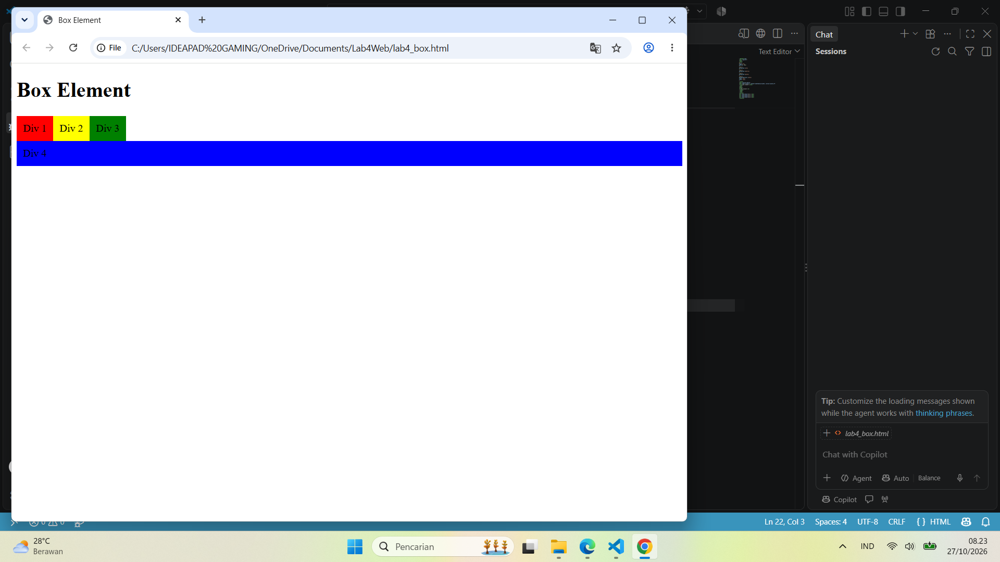

# Praktikum Lab4Web - Layout Sederhana

## Identitas Mahasiswa

**Nama:** Tegar Aldiano Kurniawan  
**NIM:** 312510058  
**Kelas:** I253B  
**Mata Kuliah:** Pemrograman Web  

## Deskripsi

Pada praktikum Lab4Web ini saya mempelajari cara membuat layout website sederhana menggunakan HTML dan CSS.

Materi yang dipelajari meliputi penggunaan `float`, `clearfix`, pembuatan layout, header, navigasi, hero panel, sidebar, widget, footer, content, dan artikel.

## Materi Praktikum

### 1. Box Element dan Float

Pada bagian ini digunakan `float` untuk mengatur beberapa elemen agar dapat berada dalam satu baris.


### 2. Clearfix

Clearfix digunakan untuk mengatasi masalah posisi elemen setelah menggunakan `float`.



### 3. Tampilan Kerangka Layout

Pada bagian ini dibuat kerangka dasar layout website sebelum ditambahkan bagian lainnya.


### 4. Tampilan Header Layout

Header merupakan bagian atas website yang berisi judul atau nama website.


### 5. Tampilan Navigasi

Navigasi digunakan untuk memudahkan pengguna berpindah dari satu halaman ke halaman lainnya.


Menu yang digunakan:

- Home
- Artikel
- About
- Kontak

### 6. Tampilan Hero Panel

Hero panel digunakan untuk menampilkan judul dan informasi utama pada halaman website.


### 7. Tampilan Sidebar, Widget dan Footer

Sidebar digunakan untuk menampilkan informasi tambahan. Widget digunakan untuk menampilkan link atau informasi tertentu, sedangkan footer berada di bagian paling bawah halaman.


### 8. Tampilan Content

Content merupakan bagian utama halaman yang digunakan untuk menampilkan informasi dan beberapa elemen website.


### 9. Tampilan Artikel

Pada bagian artikel digunakan gambar dan teks. Gambar pertama berada di sebelah kiri, sedangkan gambar kedua berada di sebelah kanan menggunakan CSS `float`.


## Teknologi yang Digunakan

- HTML
- CSS
- Visual Studio Code
- Web Browser

## Struktur Project

```text
Lab4Web/
│
├── home.html
├── artikel.html
├── about.html
├── kontak.html
├── style.css
├── README.md
│
└── images/
    ├── 01-box element float.png
    ├── 02-clearfix.png
    ├── 03-tampilan kerangka layout.png
    ├── 04-Tampilan Header Layout.png
    ├── 05-tampilan navigasi.png
    ├── 06-tampilan hero panel.png
    ├── 07-tampilan sidebar widget dan footer.png
    ├── 08-tampilan content.png
    └── 09-tampilan artikel.png
```

## Kesimpulan

Dari praktikum Lab4Web ini saya belajar membuat layout website sederhana menggunakan HTML dan CSS. Saya juga memahami penggunaan `float`, `clearfix`, header, navigasi, hero panel, sidebar, widget, footer, content, dan artikel.

Dengan praktikum ini saya menjadi lebih memahami bagaimana setiap bagian HTML dan CSS digunakan untuk membuat tampilan website yang terstruktur dan rapi.

## Author

**Tegar Aldiano Kurniawan**  
**312510058**  
**I253B**
